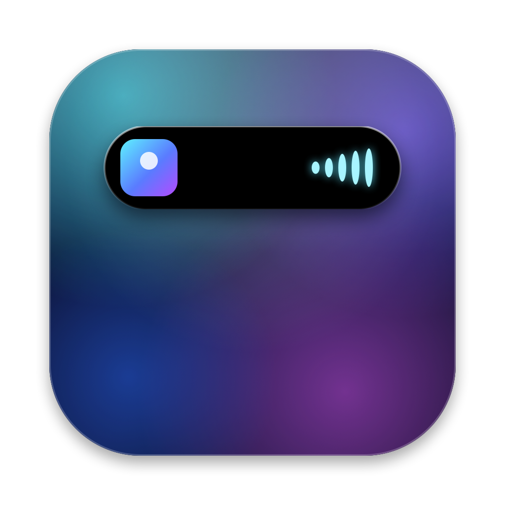

<p align="center">
  
</p>

<h1 align="center">Isle</h1>
<p align="center">
  macOS 14+ · Apple Silicon & Intel · ~6 MB of memory · <strong>0% CPU at rest</strong> · MIT licensed
</p>

---

<p align="left">
  A free <strong>Alcove/Canopy</strong> replacement built for macOS. A Dynamic Island (or Notch) for your Mac: live activities, a currently playing music card, and a Spotlight-style search inspired by the new OLED MacBook Pro.
</p>

## Features

### Now Playing

- **Live activity.** While music plays, the island shows the album artwork on one side and a waveform tinted to match the cover on the other.
- **Expanded card.** Artwork, title, and artist, a progress bar with elapsed and remaining time, and large previous / play-pause / next controls.
- **Scrubbing.** Click or drag the progress bar to seek. The bar thickens while you hover, and the island stays open while you drag.
- Works with **Apple Music** and **Spotify** (as of now).

### Charging

Plug in your MacBook and the island briefly shows feedback with a charging bolt and the current battery percentage.

### Spotlight Search

Click the expanded island or press **⌘Space** / **⌥Space** to open search. The island morphs into a search bar with blazing-speeds result.

| Type      | Example                                  | Return does       |
| --------- | ---------------------------------------- | ----------------- |
| **Apps**  | `ter` → Terminal                         | Opens the app     |
| **Files** | `invoice` → anything in your home folder | Opens the file    |
| **Math**  | `12*(3+4)^2` → 588                       | Copies the answer |
| **Web**   | anything                                 | Searches Google   |

Apps match on the start of their name, any word in it, or their initials. Keep in mind that files come from the existing Spotlight index, so nothing is crawled or indexed again.

### How to open settings?

Right-click the island and choose **Settings…**, or press **⌘,** while search is open.

#### Customization

- **Island style:** Automatic, Notch, or Floating
- **Search glass tint:** from fully clear Liquid Glass to solid black
- **Launch at Login**

---

## Installation

1. Download `Isle-<version>.dmg` from the releases.
2. Open it and drag **Isle** into **Applications**.
3. Launch Isle. It runs in the background, with no Dock icon or menu bar item.

### Replace Spotlight with ⌘Space

macOS's Spotlight owns ⌘Space by default.
To hand it to Isle, open **System Settings, go to Keyboard → Keyboard Shortcuts… → Spotlight** and turn off **Show Spotlight search**.

If you rather not disable Spotlight Search, the shortcut **⌥Space** always works out of the box.

### Permissions

The first time Isle talks to Music or Spotify (to fetch artwork, read the playback position, or send play/pause), macOS asks whether Isle may control that app.
Allow it to enable artwork, scrubbing, and the playback buttons.

Isle does **not** need Accessibility, Screen Recording, or Full Disk Access. You do not need to give it those permissions at all.

## Keyboard Shortcuts

| Shortcut                | Action                                    |
| ----------------------- | ----------------------------------------- |
| **⌘Space** / **⌥Space** | Open or close search from anywhere        |
| **↑** / **↓**           | Move through results                      |
| **Return**              | Open the selected result                  |
| **Esc**                 | Close search                              |
| **⌘,**                  | Open Settings (while searching)           |
| **⌘A ⌘C ⌘V ⌘X ⌘Z**      | Standard text editing in the search field |

## Building from Source

Requires Xcode 16 or later (Swift 5.9+). No Xcode project is needed; Isle is a Swift package.

```sh
git clone https://github.com/PowerrDev/Isle && cd Isle
./build.sh            # fast local build for your Mac's architecture
open build/Isle.app
```

### Releasing

`release.sh` builds a universal binary, signs it with the hardened runtime, packages a DMG, notarizes it with Apple, and staples the ticket.

**One-time setup:**

1. Join the [Apple Developer Program](https://developer.apple.com/programs/) ($99 a year) and create a **Developer ID Application** certificate in Xcode → Settings → Accounts → Manage Certificates. (T.B.E)
2. Store your notarization credentials:

```sh
xcrun notarytool store-credentials isle-notary --apple-id <your Apple ID> --team-id <TEAMID> --password <app-specific password>
```

**Every release:**

```sh
DEVELOPER_ID="Developer ID Application: Your Name (TEAMID)" ./release.sh
```

The finished disk image is written to `build/release/Isle-<version>.dmg`. Bump `CFBundleShortVersionString` and `CFBundleVersion` in `Info.plist` first.

## Project Structure

```
Isle/
├── Package.swift
├── Info.plist                    Bundle metadata (com.p0wer.isle)
├── Isle.entitlements             Hardened runtime + Apple events
├── build.sh                      Local development build
├── release.sh                    Universal, signed, notarized DMG
├── Resources/                    AppIcon.icns
└── Sources/Isle/
    ├── main.swift                Entry point and hidden Edit menu
    ├── App/
    │   └── HotKey.swift          Global shortcuts (Carbon, no permissions)
    ├── Island/
    │   ├── IslandPanel.swift     Transparent, non-activating panel
    │   ├── IslandModel.swift     State, modes, and geometry for both styles
    │   └── IslandController.swift  Hover, clicks, keys, search, settings
    ├── Services/
    │   ├── NowPlaying.swift      Music & Spotify, artwork, seeking
    │   ├── BatteryMonitor.swift  IOKit power notifications
    │   └── ScriptRunner.swift    Compiled, cached AppleScript
    ├── Search/
    │   ├── SearchEngine.swift    Apps, files, and web results
    │   └── Calculator.swift      Safe arithmetic parser
    ├── Settings/
    │   ├── Preferences.swift
    │   ├── SettingsView.swift
    │   └── SettingsWindowController.swift
    └── Views/
        ├── IslandView.swift      Root view and backgrounds
        ├── IslandShape.swift     Floating and notch outlines
        ├── LiveActivityViews.swift
        ├── NowPlayingCard.swift
        ├── SearchView.swift
        ├── Components.swift      Artwork, waveform, transport buttons
        └── LiquidGlass.swift     NSGlassEffectView bridge
```

## Regarding Privacy

Isle collects nothing and sends nothing anywhere. The only network request it ever makes is downloading Spotify album artwork from Spotify's own servers. Web searches open in your default browser. The app is open-source, so feel free to check it out for yourself.

## Known Limitations

- **Players:** only Apple Music and Spotify are supported. Browsers and other players need Apple's private MediaRemote framework, which recent macOS versions block for third-party apps.
- **Music's elapsed time** is read from the app when the card opens, so it needs the Automation permission to be accurate.
- **Liquid Glass** requires macOS 26. Earlier versions use a classic frosted blur.

## License

Isle is available under the [MIT License](LICENSE). You are free to use, modify, and distribute it, including in commercial projects, as long as the copyright notice is kept.
